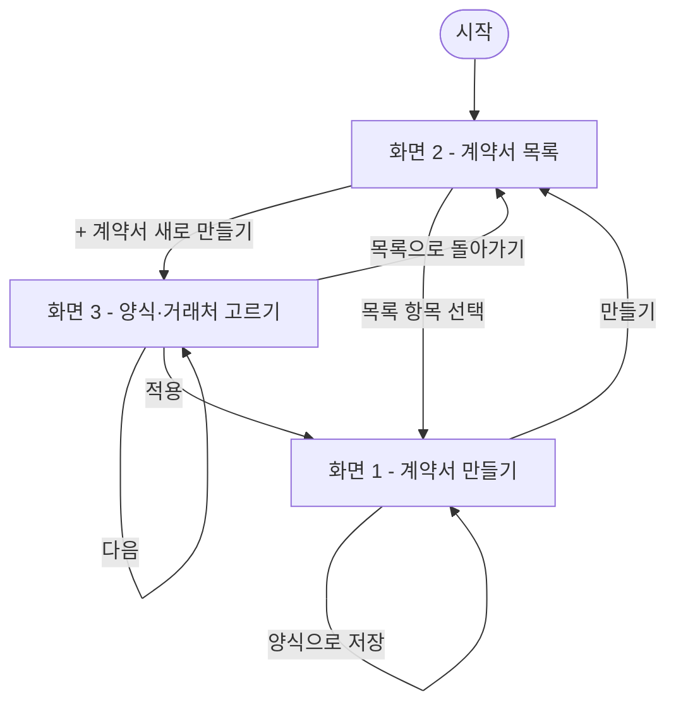

# PRD — 계약서 만들기

- 상태 : 완성
- 한 줄 정의 : 매달 여러 업체와 거래를 하는 온라인 쇼핑몰 운영자가 매번 계약서를 작성하려면 양식, 내용, 거래처 등 여러가지를 여기저기서 찾아야 하는데 온라인 쇼핑몰에서 계약서 입력창에 자료를 불러와서 빈칸을 채우면 계약서가 만들어지고 문서를 다운받아 출력한다

## 1. 문제

### 배경

- 쓰는 사람은 온라인 쇼핑몰을 혼자 운영하는 자영업자이며, 다른 사업자와 거래 할 때 계약서가 필요하다.
- 계약서 양식을 찾아 작성하는 일이 불편하고, 지금은 인쇄된 양식에 손으로 작성하고 있다.
- 이런 계약서 작성이 한 달에 여러번 계약할때 마다 반복된다.

### 목표

계약자들의 상호명·인적사항·금액·날짜 등 필요한 항목이 모두 채워져, 완전한 계약서가 완성되는 것을 목표로 한다.

## 2. 사용자

### 페르소나

- 누구 : 온라인 쇼핑몰을 혼자 운영하는 자영업자
- 상황(언제) : 다른 사업자와 상품을 거래 할 때
- 불편(왜) : 계약서 양식을 찾아 작성하기 불편함
- 지금 방법 : 그냥 인쇄된 양식에 손으로 작성한다

### 사용자 스토리

- 온라인 쇼핑몰을 혼자 운영하는 자영업자로서, 화면 1에서 거래처명·금액·날짜·계약내용을 입력해 계약서를 만들고 인쇄나 다운로드로 받고 싶다. 매번 양식과 내용을 여기저기서 찾거나 새로 입력하지 않고 계약서를 완성해 바로 쓰기 위해서다. (핵심)
- 온라인 쇼핑몰을 혼자 운영하는 자영업자로서, 만든 계약서를 화면 2의 목록에 모아두고 싶다. 나중에 예전 계약서를 다시 찾아보기 위해서다.
- 온라인 쇼핑몰을 혼자 운영하는 자영업자로서, 화면 3에서 저장해둔 양식이나 거래처 정보를 골라 불러오고 싶다. 매번 같은 내용을 새로 찾거나 입력하지 않기 위해서다.

## 3. 범위

### 넣을 기능

1. 화면 1(계약서 만들기)에서 거래처명·금액·날짜·계약내용을 입력하고 "만들기"를 누르면 입력칸 아래에 계약서가 펼쳐지며, 인쇄나 다운로드로 완성된 계약서를 받을 수 있다. (핵심)
2. 화면 2(계약서 목록)에 만든 계약서가 쌓여, 나중에 예전 계약서를 다시 찾아볼 수 있다.
3. 화면 3(양식·거래처 고르기)에서 저장해둔 양식이나 거래처 정보를 고르면, 화면 1 입력창에 불러와져서 매번 새로 찾지 않아도 된다.

### 기능 요구사항

1. 거래처명·금액·날짜·계약내용을 입력창에 넣고 "만들기" 버튼을 누르면, 입력칸 아래에 빈칸이 채워진 계약서 문서가 펼쳐진다. 거래처명·금액·날짜·계약내용 중 하나라도 비워 둔 채 누르면, 어떤 칸이 비어 있는지 짚어서 화면에 알려준다.

   펼쳐지는 계약서의 모양은 다음과 같다. 갑(쓰는 사람 본인)의 상호는 입력칸이 없으므로 빈 줄로 두고 종이에 손으로 적는다.

   ```
                   계약서

     거래처명 (을)  : (입력값)
     계약 금액      : (입력값)
     계약 날짜      : (입력값)
     계약 내용      : (입력값)

     위 내용으로 계약을 맺습니다.

     갑  상호 ____________  서명 ____________
     을  상호 (입력한 거래처명)  서명 ____________
   ```
2. 완성된 계약서 화면에서 인쇄 버튼을 누르면, 인쇄 창이 뜨고 계약서 위에 "인쇄완료" 표시가 화면에 나타난다. 종이에는 계약서만 나오고 입력칸·버튼·"인쇄완료" 표시는 나오지 않는다.
3. 완성된 계약서 화면에서 다운로드 버튼을 누르면, `계약서_거래처명_날짜.pdf` 파일이 내려오고 "다운로드 완료" 안내가 화면에 나타난다. 거래처명에 파일 이름으로 쓸 수 없는 글자가 있으면 `_`로 바꾼다.
4. "만들기"로 계약서를 만들면, 계약서 목록(화면 2)에 새 항목으로 쌓인다. 계약서 목록에서 항목을 선택하면 해당 계약서의 입력창(화면 1)이 열려 내용을 수정하고 다시 인쇄·다운로드할 수 있다. 쌓인 계약서는 브라우저를 닫았다 열어도 남아 있다.
5. 저장된 양식 목록(화면 3, 1단계)에서 양식을 고르면, 그 양식의 본문이 계약서 만들기 입력창(화면 1)의 계약내용 칸에 채워진다. 양식 목록에는 처음부터 기본 양식 3개("기본 계약서 양식", "용역 계약서 양식", "납품 계약서 양식")가 들어 있고, 완성된 계약서 화면에서 "양식으로 저장"을 누르면 지금 계약내용 칸의 글이 새 양식으로 목록에 추가된다.
6. 저장된 거래처 목록(화면 3, 2단계)에서 거래처를 고르고 "적용"을 누르면, 그 거래처 정보가 화면 1 입력창에 불러와진다.

### 비목표

1. 전자서명·도장 — 서명과 도장은 인쇄한 종이에 손으로 하므로, 화면에서는 서명 빈 줄만 인쇄하고 법적 효력 확인은 하지 않는다.
2. 로그인·회원가입 — 혼자 쓰는 도구이고 자료가 쓰는 사람의 브라우저 안에만 있으므로, 계정을 나눌 까닭이 없다.
3. 여러 사람이 함께 쓰기 — 페르소나가 "혼자 운영하는 자영업자"라, 같은 계약서를 여럿이 나눠 보는 일이 없다.

## 4. 화면

### 사용자 흐름

- 시작 - 앱을 열면 화면 2(계약서 목록)가 먼저 보인다.
- 화면 1 - 계약서 만들기 : 거래처명·금액·날짜·계약내용을 입력하고 "만들기"를 누르면 입력칸 아래에 완성된 계약서가 펼쳐지고, 인쇄 버튼을 누르면 인쇄 창이 뜨며 "인쇄완료" 표시가, 다운로드 버튼을 누르면 PDF 파일이 내려오며 "다운로드 완료" 안내가 화면에 나타나고, "양식으로 저장" 버튼을 누르면 지금 계약내용이 화면 3의 양식 목록에 새 양식으로 추가된다. 만든 계약서는 화면 2의 목록에 쌓인다.
- 화면 2 - 계약서 목록 : 만든 계약서가 목록에 쌓이고, 항목을 선택하면 화면 1의 입력창으로 돌아가 내용을 고쳐 인쇄·다운로드할 수 있으며, "+ 계약서 새로 만들기"를 누르면 화면 3으로 이동한다.
- 화면 3 - 양식·거래처 고르기 : "다음"을 누르면 다음 단계(양식 고르기 → 거래처 고르기)로 넘어가고, 거래처까지 고른 뒤 "적용"을 누르면 화면 1로 돌아가 입력창에 고른 양식·거래처 내용이 채워지며, "목록으로 돌아가기"를 누르면 화면 2로 돌아간다.



## 5. 완성 기준

### 수용 기준

1. 거래처명·금액·날짜·계약내용을 입력창에 넣고 "만들기" 버튼을 누르면, 입력칸 아래에 빈칸이 채워진 계약서 문서가 화면에 펼쳐진다.
2. 완성된 계약서 화면에서 인쇄 버튼을 누르면, 인쇄 창이 뜨고 계약서 위에 "인쇄완료" 표시가 화면에 나타난다.
3. 거래처명·금액·날짜·계약내용 중 하나라도 비워 둔 채 "만들기"를 누르면, 화면에 어떤 칸이 비어 있는지("거래처명을 넣지 않았습니다" 등) 짚어서 보여준다.
4. 완성된 계약서 화면에서 다운로드 버튼을 누르면, `계약서_거래처명_날짜.pdf` 파일이 내려오고 "다운로드 완료" 안내가 화면에 나타난다.
5. "만들기" 버튼을 눌러 계약서를 만들면, 화면 2의 계약서 목록에 새 항목이 나타나고, 브라우저를 닫았다 다시 열어도 그 항목이 목록에 남아 있다.
6. 계약서 목록에서 항목을 선택해 입력창에서 내용을 고친 뒤 인쇄 버튼을 누르면 계약서 위에 "인쇄완료" 표시가, 다운로드 버튼을 누르면 "다운로드 완료" 안내가 화면에 나타난다.
7. 화면 3에서 양식을 고르고 "다음"과 "적용"을 누르면, 화면 1의 계약내용 칸에 그 양식의 본문이 채워져 나온다.
8. 화면 3에서 거래처를 고르고 "적용"을 누르면, 화면 1의 입력창에 그 거래처 정보가 채워져 나온다.
